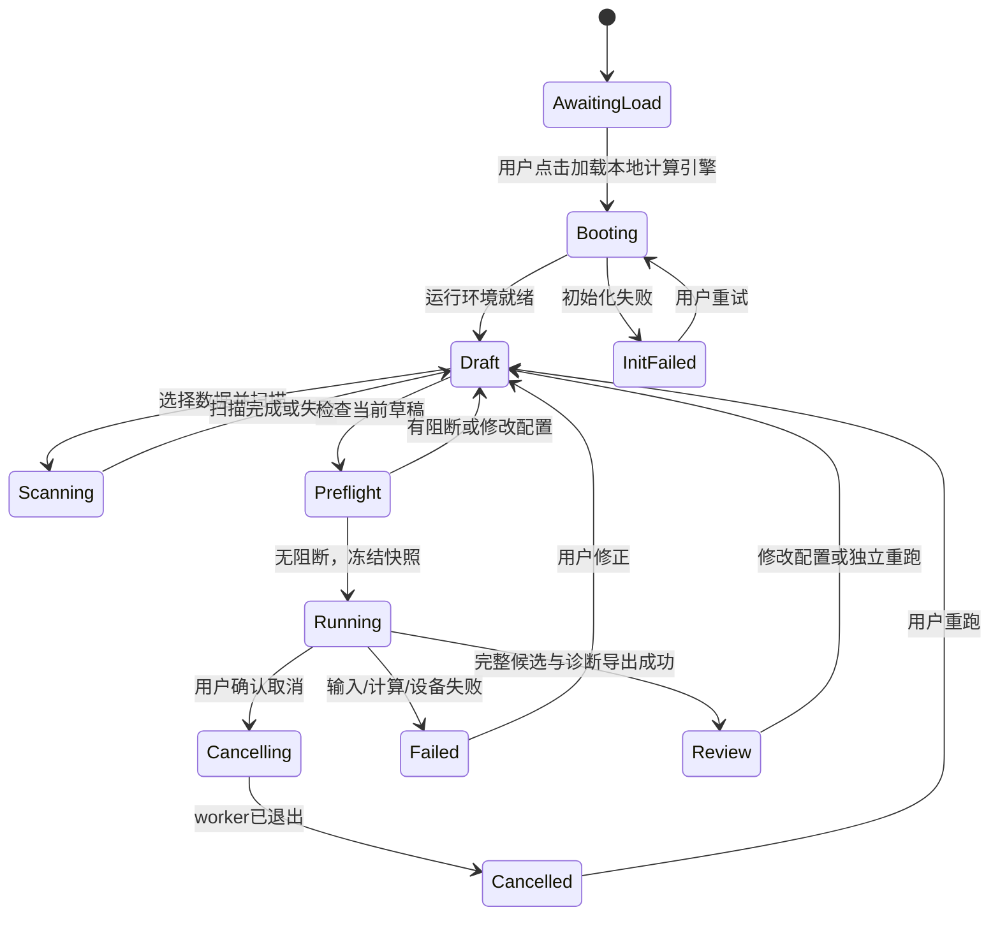

# 网页工作台形态与交互设计

`web/design/` 保留设计原型；`web/app/` 已接入真实 WASM 标定以及单线程和 Rayon 多线程 CPU 执行档，实测边界见 [WASM CPU 实施与验证记录](wasm-acceleration-plan.md)。当前交互调整目标是完整表单默认流程：无需编写配置文件，复杂诊断仅按需展开。原型不是生产应用，不能用原型交互冒充引擎验证。

## 1. 产品形态

桌面优先的本地计算工作台，而不是上传服务器的网站。生产页为七个连续纵向区块，浅色、森林绿、细边框、统一控件高度与紧凑表格。顶部步骤链接是页内锚点，不再切换隐藏页面；不使用整屏滚动吸附。完成阶段后只向下一块平滑滚动一次并短暂高亮，不跟随每条进度抢滚动位置；减少动态效果设置下取消过渡。窄屏保留单列结构，表格在局部横向滚动，不令全页溢出。

生产前端采用无外部依赖的ES模块与语义HTML/CSS，算法仍在Rust/corelib。表单读写同一RunSettings草稿，Rust负责权威校验，不另建配置合同。视觉取白底、淡绿分区、森林绿操作、细边框和适量圆角；数字等宽，状态总有文字而不只用颜色。使用系统字体，不额外下载字体。

## 2. 七个连续区块

| 区块 | 内容与操作 | 进度与约束 |
|---|---|---|
| 引擎加载 | 显示用途、源码/反馈链接、数据处理说明；用户点击加载后下载、编译、初始化线程；完成后显示版本与完整构建标识 | 首次建立资源校验/隔离环境可能刷新一次并续接用户请求；下载采用已校验 manifest 字节总和；编译与线程初始化不编造百分比 |
| 文件导入 | 统一点击/拖放入口，支持文件集合与 ROS2 目录；格式选择、文件摘要 | 文件授权后自动解析；换源清除旧扫描和旧话题，保留板与求解草稿 |
| 读取解析 | 当前阶段、实际读取字节与调用次数、取消与错误恢复 | 随机读取可能重复，累计读取量不是整包完成比例；没有可信总工作量时显示不定进度 |
| 话题选择 | 紧凑表格列出话题、类型、数量/频率、启用选择、相机 ID 与模型 | 首次解析默认启用全部可用图像，按路径自然排序分配 cam0、cam1…；支持一路 IMU，默认选排序后的第一路并提示可切换。依相机数量和 IMU 自动推断模式；重新解析保留手动选择与 ID；不可用话题只读 |
| 配置 | 多 Tab 收纳标定板、求解参数与 CPU 算力；保留高级配置导入与导出 | 使用同一 RunSettings 草稿与 Rust 权威校验；仅 CPU 单线程/多线程，不自动降档 |
| 计算监控 | 读取/检测/求解阶段动画、帧数、速度、线程数、逐帧结果、真实图像与 IMU 信息 | 图像为有界采样缩略图，逐帧表为有界最近记录；无 IMU 或预览时明确显示缺失，不模拟数据 |
| 标定结果 | 逐相机误差、内参、适用外参及内嵌可旋转投影视图、IMU/时钟参数、诊断和下载 | 只渲染本次真实输出；外参图对 camera-from-reference 求逆显示共同参考系内的相机位置；收敛不等于人工验收 |

正常流程无需手写配置文件。标定板与求解字段以当前 `RunSettings` 为准；高级文本编辑仅在应用成功后更新草稿。开始前自动执行权威检查；运行期间冻结本次配置，不允许新编辑改变当前求解。结果中的缺失数值不补零，失败和取消不发布成功结果。

Agent API 不额外占据流程区块，仍通过页面 `window.fourP` 调用。请求、权限、幂等、取消与文件绑定见 [Agent 浏览器 API 契约](browser-agent-api.md)。静态页面不提供外部 HTTP/MCP 服务。

生产页面的 CSP、启动授权、资源完整性与本地打包边界见 [浏览器安全与本地发布](browser-security.md)。这些措施不是恶意网站名单解除证明。

## 3. 运行与并发状态

- 每条异步消息携带 protocolVersion、runId/sourceRevision、sequence；旧运行不能覆盖当前界面。事件映射当前 runner 的 Stage、DetectionProgress、Dataset、SolveProgress、SolveActivity、SolveSummary、Message。
- 扫描/检测仅在总量可靠时显示完成量/总量与估计剩余时间。求解只显示迭代、cost、阻尼、梯度、接受/拒绝步；迭代上限不是进度条分母，ETA 显示未知。
- 检测曲线保留完整运行数据，绘图可做显示降采样但不得改变统计；各求解阶段独立曲线，不将不同目标函数直接连线。
- 运行中编辑的是下次运行草稿，不能更改正在执行的快照。离开当前工作区不取消；刷新/关闭时用浏览器允许的离开提示，不承诺关标签后继续计算。
- 取消先确认，显示“正在等待安全点”；原子取消标志需核心在安全点检查。单线程长同步调用不能靠 postMessage 即时取消。超出用户等待意愿时提供明确的“强制终止并丢弃本次结果”，不是伪装成功的软取消。
- 内存不足、配额耗尽和 Worker/线程池失败显示发生阶段、所选 CPU 执行档与实际线程数，不自动改用另一档接着跑。用户修改执行档后创建独立新运行，诊断保留原失败信息。

## 4. 初始化与加载动画

### 分阶段，不遮挡整个应用

HTML/CSS 壳先到先显示；导航、隐私说明、版本和初始化面板先可见。初始文件选择保持不可用，直到必要的隔离刷新已经完成。加载面板占据工作区顶部，不使用无信息的全屏 spinner。慢加载时仍可查看部署帮助和失败详情。

| 阶段 | 可显示的信息 | 动画/完成依据 |
|---|---|---|
| 获取 manifest / 确认隔离 | 版本、目标 CPU 执行档、是否需要一次刷新 | 不定进度；有界重载，失败显示原因 |
| 下载 JS/WASM | 已收到字节、总字节（仅可信时）、资源名、网络失败 | 已知且同一统计口径时百分比；压缩 Content-Length 与解压流字节不混算；否则字节累计+不定进度 |
| 编译与实例化 WASM | 模块名、耗时、缓存命中仅在确证时显示 | 不定进度；Promise 完成才标记就绪，不能靠定时器增加百分比 |
| 启动计算 Worker | Worker ready；Rayon 档显示已就绪/计划线程数 | 真实计数；线程池必须完整初始化，不能缩减线程数后冒充成功 |
| 就绪 | `cpu-single` 或 `cpu-rayon`、build id、实际线程数、引擎版本 | 停止动画；解锁输入与启动前检查 |

下载与编译可重叠，不简单相加冒充总完成度。计时器只用于耗时/动画，不推动业务状态。进度短时间内很快完成时无需强制延迟动画；不要人为让用户等待。

### 失败、恢复与可访问性

- 同一初始化只能有一个 active attempt；重试取消旧 fetch、销毁旧 Worker 并忽略旧 attempt 回调。超时显示“未完成”而不是宣称不支持；用户选择重试，不无限重载。
- COI Service Worker 首次安装/刷新发生在选择 bag 之前；提前说明原因。更新仅在空闲且保存草稿后由用户触发，不在运行中强制刷新。
- 首屏网络失败仍有静态文字说明，`noscript` 给出必须启用 JS 的提示。JS 启动失败时不应永久显示“正在准备”。
- 进度容器 `aria-busy`；状态 `role=status` / polite live region，阶段变化播报，字节与计时不每帧播报；失败 `role=alert` 并聚焦可恢复操作。
- `prefers-reduced-motion: reduce` 停用旋转/扫光，保留状态文字、静态进度和耗时。动画仅改变 transform/opacity，不不停触发布局。
- 原型“加载状态设计”选择器只查看设计状态，无假下载字节、假求解结果；真实探测只报告 Worker 握手、跨源隔离、共享内存与线程能力，不能把环境探测称为 WASM 引擎验证。

## 5. 输入、草稿与结果交互细节

文件绑定后立即进入真实解析；解析结束才展示话题并滚动到选择表格。ROS2 多文件按目录相对路径绑定，保留 metadata.yaml 关系；不同目录同名文件不得悄悄覆盖。全量 bag 不做 JSON/base64 往返；监控缩略图单独有界传送。

浏览器草稿可持久化设置，但不会因此恢复 File 权限；刷新后明确要求重新绑定文件。正式实现保存 RunSettings/schema 版本、来源摘要、配置快照、CPU 执行档、build id、实际线程数、核心版本和导出诊断，发布产物完整成功才显示可下载结果。JSON bridge 的纳秒 i64 使用十进制字符串/BigInt，禁止转 JS Number。

结果默认先“概览与风险”，再“内参 / 外参 / IMU与时钟 / 诊断 / 文件”。内外参坐标系方向标在列名，旋转单位明确。图表选点定位相机/帧；无该项结果时显示“不适用”或“未产生”，不能用 0 补齐。人工验收记录独立保存，不篡改求解终止原因。

## 6. 原型查看与验收

在仓库根目录运行 `python3 -m http.server 8765 --bind 127.0.0.1`，访问 `http://127.0.0.1:8765/web/design/`。发布原型时保留 `web/design/` 与 `docs/` 相对目录关系，或在生成发布目录时同步调整文档链接；不要只上传网页目录后留下失效的文档链接。资源均相对路径，无外部字体、CDN、分析服务，不注册 Service Worker。正式 COI/引擎部署见技术方案。

交互验收：六工作区与 Agent API 入口导航、格式与文件元信息、非法板 ID 反馈、板间距预览、两种 CPU 执行档说明、真实能力检测、预检持续阻止未接入引擎启动、加载状态设计与 reduced-motion、键盘焦点、窄屏无整体横向溢出。原型不提供伪造的运行、RMS、性能加速倍数或成功下载。

生产验收额外覆盖：`cpu-single` 与 `cpu-rayon`、所有模式与输入格式、初始化失败和更新、取消、离线/慢网/配额不足、长任务内存，以及技术方案的原生/WASM/corelib/OpenCV 数值对照。当前原型的浏览器检查不代表这些生产能力已验收。

### 本次原型验证记录

已在本地 HTTP 服务的 Chromium 页面验证：七个导航入口及标题焦点；重复/非矩形 ID 拒绝与 36-ID 布局恢复；间隙预览；真实文件元信息与格式切换清除绑定；未隔离线程方案和未接入引擎的启动阻断；六种加载设计状态及环境重新检测。实际 Worker 握手成功；环境探测本身不等于 WASM 标定引擎完成数值验证。

1440px 桌面与 390px 窄屏均已截图检查；390px 页面无整体横向溢出。模拟 reduced-motion 后 spinner 的 animationName 为 none。浏览器页面错误列表为空。原型记录没有运行 WASM 构建、标定求解或数值对照；CPU 浏览器实现的实测结果单独记录在技术文档中。

### 连续七区块生产页验证（2026-11-12）

- 重新构建 CPU 单线程和 Rayon 引擎；9 项原生输入测试通过，双档静态打包通过。
- Chromium 实测初始化资源条随真实累计下载字节增长至 100%，随后编译进入不定进度，再进入就绪状态；无定时器伪造百分比。
- 实际点击统一文件选择按钮加载 `ext_sync_exp_1600.bag`，自动解析出四路相机和一路 IMU。解析显示实际累计读取 2.99 GB / 14912 次调用，该值含随机重复读取，不当作整包完成比例。
- cam0、Double Sphere、4 Worker 完整处理 2265 帧；出现真实灰度与角点缩略图、FPS、实际线程数与逐帧结果。逐帧表仅保留最近 200 行，容器最大 320 px，完整数值诊断可下载。最终参数与此前 CPU-only 结果逐值一致；RMS 0.2950456545732174 px、P95 0.49660939540929877 px、153368 求解点、8 拒绝点。
- 另以两相机 + IMU 启动，实际观察到 13372 个已读 IMU 样本及精确字符串纳秒时间、角速度、比力；协作取消后明确未发布未完成结果。本次不声称完成联合标定数值验收。
- 1440 px 桌面和 390 px 窄屏截图检查；窄屏页面宽度保持 390 px、话题表局部横向滚动。Tab 的方向键导航有效；减少动态效果时滚动为 auto，计算动画为 none。浏览器错误列表为空。
- 外参组件用明确标注的合成几何夹具验证平移/旋转求逆、视角交互及无外参时不显示；夹具已删除。真实整包闭环为单相机，不冒充真实 rig 外参验收。

本次为 UI/只读遥测重构，没有更改检测与求解算法。上述端到端检查不替代固定 `baton_bag` 与 OpenCV/corelib 双后端正式数值基线。

### 合并布局编辑与多相机预览（2026-11-13）

标定板的正视 ID 格子同时承担输入与布局展示，移除重复只读预览；几何参数与可编辑格子并排，显示板尺寸。浏览器验证修改 ID 后切换 Tab 可保留值，再恢复原值。

计算监控为每个启用相机分配独立画布，桌面双列排列；每格显示相机 ID、精确时间戳、角点数，并注明抽样非同步画面。真实 `ext_sync_exp_1600.bag` 四相机运行中验证四格分别更新，截图后协作取消，无浏览器错误。本次只验证图像监控，不代表完成四相机联合数值验收。

计算活动条改为最近 100 帧的真实 Tag 数柱带：一柱一帧，右侧最新，按完成事件顺序更新，零 Tag 使用灰色基线标记，无新帧不播放循环动画。纵轴初始为标定板 Tag 总数，异常更大值出现时统一扩展，不截断数据。多相机完成顺序不表示同步时间轴。FPS 为后端至少 250 ms 窗口的全相机合计完成吞吐，平均值为检测计时段累计吞吐。

详细运行日志不再序列化预览像素数组；只保留尺寸、角点数量和数值遥测。页面最多显示 100 条摘要，点击单条才生成 JSON 文本，完整数值诊断仍由产物下载。已用真实 bag 在运行中展开日志并观察真实柱带，取消正常、浏览器无错误；未将该功能检查宣称为性能基准。

### 结果三维交互与参数检索

外参视图使用本地随站点分发的 Three.js/WebGL 渲染器，按需加载，不依赖运行时 CDN。左键拖动旋转、右键拖动平移、滚轮缩放，保留重置视角，不使用角度滑动条。显示相机朝向、位置与参考坐标轴；原始 camera-from-reference 求逆后进入共同参考系。没有外参时不绘制假位姿；WebGL 不可用时明确报错，数值参数仍可查阅。视图仅在交互或尺寸变化时重绘，结果替换时释放渲染资源。

参数浏览与三维视图分离：顶部保留逐相机误差；内参按相机分组，外参按变换方向分组，IMU 与时钟单独分组。参数名称/相机 ID/变换方向可检索，匹配时展开对应分组，无结果明确提示；筛选不重建三维场景。不改变原始输出字段与数值，也不以重投影误差代替人工验收。

浏览器交互验证：明确标注的四相机 + IMU 合成夹具下，左键旋转、右键平移和滚轮缩放分别产生实际渲染变化；无视角滑块。`cam2 fx` 组合搜索精确定位单项焦距，`clock_skew` 找到时钟漂移组；空匹配有提示。结果重新渲染后仅一个画布，无外参结果不创建画布；390 px 窄屏无全页横向溢出。验证期间修复了一处相机模型显示辅助函数遗漏，修复后无新增页面错误；临时夹具已删除。本次为展示层验证，不代表真实四相机联合标定验收。

## 监控文字与投影模式更新

- 检测状态行保留最近一次帧数与平均 FPS；同阶段的日志、IMU 和重复阶段事件不会清空摘要。只有阶段真正变化或新运行才清除，文本相同时不重复写 DOM，数字使用等宽字形。
- 外参视图增加“投影方式”：默认透视，可切换平行（正交）。切换保留观察中心和朝向，按中心平面可见高度匹配缩放；两种模式均支持 OrbitControls 与视角方块，重置保持当前投影模式。
- 正交视锥随容器宽高比更新，缩放有界；切换取消正在进行的方块对齐动画，销毁时移除切换监听。只改变展示，不改外参数据。
- 验证：进度摘要两项回归通过；浏览器合成夹具中交错日志/IMU 后帧数与 FPS 保持，实际正交切换、缩放、旋转、重置及切回透视通过，页面错误为 0。合成展示验证不属于数值标定验收。
